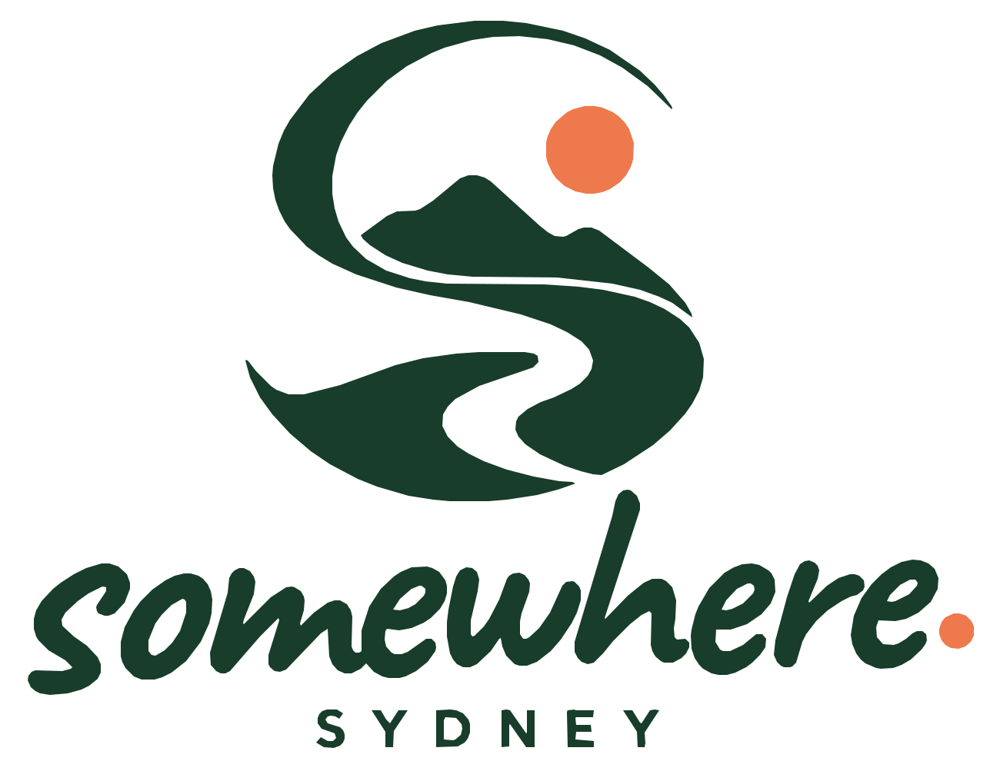
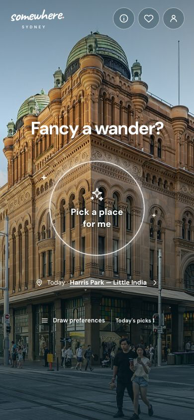
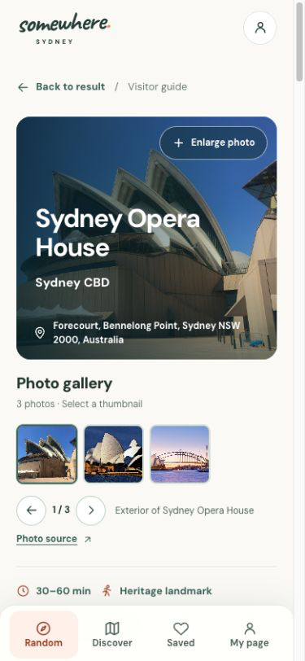

# Somewhere Sydney

**Less deciding. More going.**

A bilingual companion for spontaneous days out in Sydney. Open Somewhere, get a place, and follow a detailed guide — without building an itinerary first.

[Explore in English](https://somewhere.censun.org/?lang=en) · [简体中文](https://somewhere.censun.org/?lang=zh-CN)

## An outing, with less planning

- **Start with no decisions.** Origin, date, available time, transport and preferences are all optional.
- **Find your kind of Sydney.** Nature, coast, neighbourhoods, art, culture, food and cafés; browse famous attractions or explore quieter places.
- **Arrive with a plan.** Detailed bilingual introductions, local history, visit routes, practical advice and three photographs per place.
- **Make it personal.** Optional filters, favourites and exclusions; one initial pick and three swaps a day, stored on your device.
- **Keep the next step close.** Explore the embedded map or open destination-ready navigation.

The current collection includes **177 places, 531 photographs and 54 starting areas**. Photos include clearly dated historical images. Transport times are estimates; availability uses recorded opening and review information.

## Availability

The web preview supports English and Simplified Chinese on desktop and mobile browsers. Android and iOS projects are being validated; **no store release is available yet**. There are no accounts or ads. Optional Google Analytics visitor statistics load only after consent, which can be withdrawn in settings. Location is optional and processed on your device.

## About this repository

This is the public product presentation and legacy website distribution repository. GitHub Pages now forwards to [somewhere.censun.org](https://somewhere.censun.org/), preserving language parameters and page links. Development sources, maintenance databases, research and development history remain private. Retained browser assets and the published catalog under `site/` remain retrievable for older links and app builds.

Original project-owned code, branding and editorial content are **proprietary; commercial reuse is not permitted**. This is not an open-source release. See [LICENSE](LICENSE) and [rights and credits](NOTICE.md). Third-party works retain their independent licences; those rights are not replaced by the project restriction.

Built with React, TypeScript and Capacitor. [Photo credits](CREDITS.md) · [Third-party software notices](site/THIRD_PARTY_NOTICES.txt)

## Contact

Ideas, corrections or product enquiries: **somewhere.globe@gmail.com**.

中文：Somewhere 帮你随机选一个悉尼目的地，所有偏好都可留空；中英文攻略、实景图库、地图、收藏与排除均已接入。这里仅展示产品并分发网页产物，开发源码与维护资料不公开。项目拥有权利的原创内容禁止商用，第三方素材遵循各自许可。
